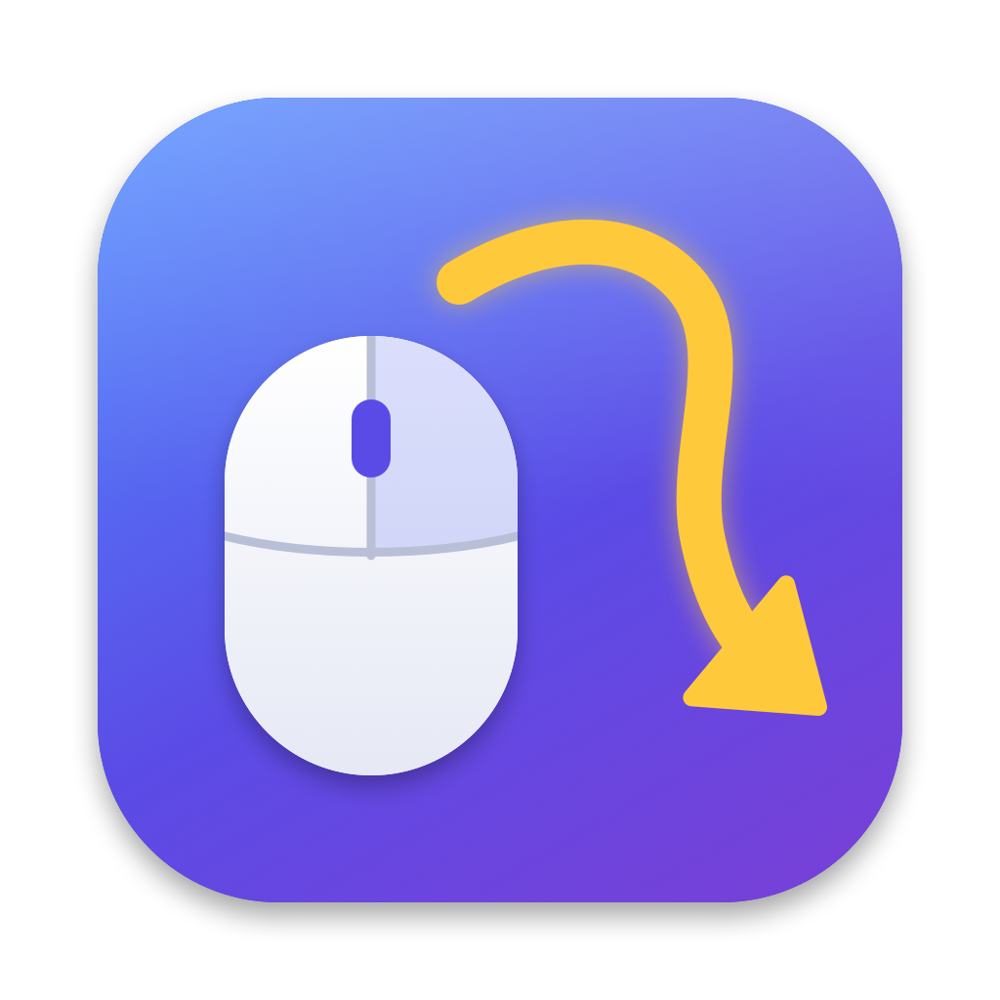

<p align="center">
  
</p>

<h1 align="center">Strokey</h1>

<p align="center">
  Mouse gestures, side-button mapping and smooth scrolling for macOS.<br>
  Works with any mouse. No vendor drivers needed.
</p>

<p align="center">
  <b>English</b> · <a href="README.zh-CN.md">简体中文</a>
</p>

---

## Features

| Feature | How | Default |
|---|---|---|
| **Right-button gestures** | Hold the right button, draw a direction, release | ← Back, → Forward, ↓→ Close tab… (see below) |
| **Middle-button gestures** | Hold the middle button and drag | ↑ Mission Control, ↓ App windows, ← / → Switch desktop |
| **Side buttons** | Click the back / forward side buttons | Back / Forward, also in Finder and Safari |
| **Wheel gesture** | Hold the right button and scroll | Previous / next tab |
| **Rocker gesture** | Hold right, click left / Hold left, click right | Back / Forward |
| **Smooth scrolling** | Automatic, applies to regular mouse wheels only | ⇧ horizontal scroll, ⌥ precise scroll |
| **Cancel a gesture** | Hold still for 0.8 s before releasing | — |

A plain right-click or middle-click without dragging works as usual (context menu, open link in new tab).

While you draw, Strokey shows the trail and the action that will run on release.

### Default right-button gestures

| Gesture | Action | Gesture | Action |
|---|---|---|---|
| ← | Back | ↑ ↓ | Reload |
| → | Forward | ↑ ← / ↑ → | Previous / next tab |
| ↑ | Scroll to top | → ↓ | Minimize window |
| ↓ | Scroll to bottom | → ↑ | Maximize window |
| ↓ → | Close tab | ← ↓ → | Tile window left |
| ↓ ← | Reopen closed tab | → ↓ ← | Tile window right |

## Install

Requires macOS 13 Ventura or later. Runs natively on both Apple Silicon and Intel Macs.

### Option 1: One-line install (recommended)

```bash
curl -fsSL https://raw.githubusercontent.com/JiaCheng310/Strokey/main/scripts/install.sh | zsh
```

This downloads the latest release, installs it to `/Applications` and launches it.

### Option 2: Download manually

1. Download `Strokey-x.y.z.zip` from [Releases](https://github.com/JiaCheng310/Strokey/releases) and unzip it.
2. Drag `Strokey.app` into `/Applications`.
3. Open it. Strokey is not notarized by Apple (that requires a paid developer account), so macOS blocks it the first time:
   - **macOS 15 Sequoia and later**: try to open it once, then go to **System Settings → Privacy & Security**, scroll down and click **Open Anyway**.
   - **macOS 13 / 14**: right-click `Strokey.app` → **Open** → **Open**.
   - Or run this in Terminal:
     ```bash
     xattr -dr com.apple.quarantine /Applications/Strokey.app
     ```

### Option 3: Build from source

Requires Xcode or the Command Line Tools (`xcode-select --install`).

```bash
git clone https://github.com/JiaCheng310/Strokey.git
cd Strokey
make install
```

### Grant Accessibility permission

Strokey needs Accessibility permission to see mouse events and send shortcuts. On first launch:

1. macOS asks for permission. Open **System Settings → Privacy & Security → Accessibility**.
2. Turn on **Strokey**.
3. The menu bar icon changes from ⚠️ to ✋ within a couple of seconds. No restart needed.

> **After updating**, macOS may treat the new version as a different app, because it is not signed with a developer certificate. If gestures stop working, remove Strokey from the Accessibility list with **−** and add it again.

## Usage

Click the ✋ icon in the menu bar to:

- Turn gestures or smooth scrolling on and off
- Launch Strokey at login
- Open or reload the config file
- Check for updates

## Configuration

The config file lives at `~/.config/strokey/config.json`. It is created on first launch. After editing it, choose **Reload Config** from the menu.

```jsonc
{
  "minStroke": 30,            // Minimum stroke length in pixels; smaller = more sensitive
  "showTrail": true,          // Show the trail and action hint
  "excludeApps": ["com.valvesoftware.steam"],   // Don't intercept mouse buttons while these apps are frontmost (e.g. games)

  // Right-button gestures. L = left, R = right, U = up, D = down
  "global": {
    "DR": { "name": "Close tab", "key": "cmd+w" },
    "LU": { "name": "Open Terminal", "shell": "open -a Terminal" },
    "RU": { "name": "Maximize", "action": "windowMaximize" }
  },

  // Per-app overrides by bundle id. Look one up with: osascript -e 'id of app "Safari"'
  "apps": {
    "com.apple.finder": { "U": { "name": "Enclosing folder", "key": "cmd+up" } }
  },

  // "2" = middle button, "3" / "4" = side buttons. click = single click, drag = gestures while held
  "buttons": {
    "2": { "drag": { "U": { "action": "missionControl" } } },
    "3": { "click": { "name": "Back", "key": "cmd+[" } },
    "4": { "click": { "name": "Forward", "key": "cmd+]" } }
  },

  "wheelGesture": { "up": { "key": "ctrl+shift+tab" }, "down": { "key": "ctrl+tab" } },
  "rocker": { "rightThenLeft": { "key": "cmd+[" }, "leftThenRight": { "key": "cmd+]" } },

  "scroll": {
    "enabled": true,
    "reverse": false,         // Reverse the mouse wheel only; trackpads are unaffected
    "speed": 1.0,
    "smoothness": 0.25,       // Higher = smoother, lower = more responsive
    "acceleration": true
  }
}
```

### Actions

Each action can use one or more of:

- `"key"`: a keyboard shortcut, e.g. `cmd+shift+t`, `ctrl+left`, `f11`. Modifiers: `cmd` `shift` `opt` `ctrl` `fn`. Shortcuts follow your current keyboard layout.
- `"shell"`: a shell command, e.g. `open -a Safari`.
- `"action"`: a built-in action:

| Built-in action | Description |
|---|---|
| `missionControl` / `appExpose` / `showDesktop` / `launchpad` | Mission Control / App windows / Show desktop / Launchpad |
| `back` / `forward` | Back / Forward. Chrome, Edge, Brave, Vivaldi: the browser's own back command, which pages can't block (asks once for permission to control the browser). Arc, Firefox: side-button click. Other apps: ⌘[ / ⌘] |
| `scrollTop` / `scrollBottom` | Scroll the area under the pointer to the top / bottom (works regardless of keyboard focus) |
| `spaceLeft` / `spaceRight` | Switch to the desktop on the left / right (shows a hint at the edge) |
| `windowLeft` / `windowRight` / `windowMaximize` / `windowCenter` / `windowMinimize` | Tile left / Tile right / Maximize / Center / Minimize |
| `volumeUp` / `volumeDown` / `mute` | Volume |
| `playPause` / `nextTrack` / `previousTrack` | Media controls |
| `brightnessUp` / `brightnessDown` | Display brightness |

`name` is optional. It's the label shown while drawing.

## Privacy

Strokey intercepts mouse events, so here is exactly what it does:

- **Mouse only.** It listens to mouse buttons, drags and scroll wheel events. It does **not** listen to your keyboard. It only *sends* keystrokes when a gesture you configured asks for one.
- **Browser control (optional).** In Chrome, Edge, Brave and Vivaldi, back / forward asks once for permission to control the browser. Strokey only sends "go back" / "go forward" to the active tab. It never reads pages, URLs or history. If you decline, it falls back to a side-button click.
- **No network.** Strokey never connects to the internet. "Check for Updates" just opens the Releases page in your browser.
- **No data collection.** Nothing is recorded, stored or uploaded. The only file it writes is your config file.
- **Local logs only.** For troubleshooting, the name of each triggered action goes to the macOS system log on your Mac.
- **Open source.** Every line is in this repository. Read it or build it yourself.

## Troubleshooting

| Problem | Fix |
|---|---|
| Menu bar icon shows ⚠️ | Accessibility permission is missing. Click the icon → open settings and enable Strokey. |
| Nothing happens after an update | Remove Strokey from the Accessibility list with **−**, then add it again. |
| Desktop switching doesn't work | Make sure **System Settings → Keyboard → Keyboard Shortcuts → Mission Control → Move left/right a space** is enabled. |
| A game or app needs the right-button drag | Add its bundle id to `excludeApps`. |
| Mouse feels stuck | Press ⌘⌥⎋ and force quit Strokey. Then [open an issue](https://github.com/JiaCheng310/Strokey/issues) with the logs below. |

Logs:

```bash
log show --last 10m --predicate 'subsystem == "io.github.jiacheng310.strokey"'
```

## Uninstall

1. Click the menu bar icon → **Quit**.
2. Delete `/Applications/Strokey.app`.
3. Remove Strokey from **System Settings → Privacy & Security → Accessibility** (and from **Login Items** if you enabled it).
4. Optionally delete your config: `rm -rf ~/.config/strokey`.

## Development

```bash
make build     # Build build/Strokey.app (universal)
make run       # Build and run without installing
make install   # Build, install to /Applications and launch
make dist      # Build the release zip in dist/
make icon      # Regenerate the icon from scripts/make_icon.swift
```

| File | What it does |
|---|---|
| `Sources/Strokey/main.swift` | Event tap setup, menu bar |
| `Sources/Strokey/Engine.swift` | Gesture recognition (drag, wheel, rocker) |
| `Sources/Strokey/SmoothScroll.swift` | Smooth scrolling |
| `Sources/Strokey/Actions.swift` | Shortcuts, built-in actions, window management |
| `Sources/Strokey/Overlay.swift` | Trail and hint overlay |
| `Sources/Strokey/Config.swift` | Config loading and saving, UI strings |

To publish a release, push a tag. GitHub Actions builds the app and attaches the zip:

```bash
git tag v1.0.0 && git push origin v1.0.0
```

Some built-in actions (Mission Control, desktop edge detection) use private macOS APIs. That's fine for apps distributed outside the Mac App Store, but these actions may break in future macOS versions. Strokey falls back gracefully when they're unavailable.

## License

[MIT](LICENSE)
